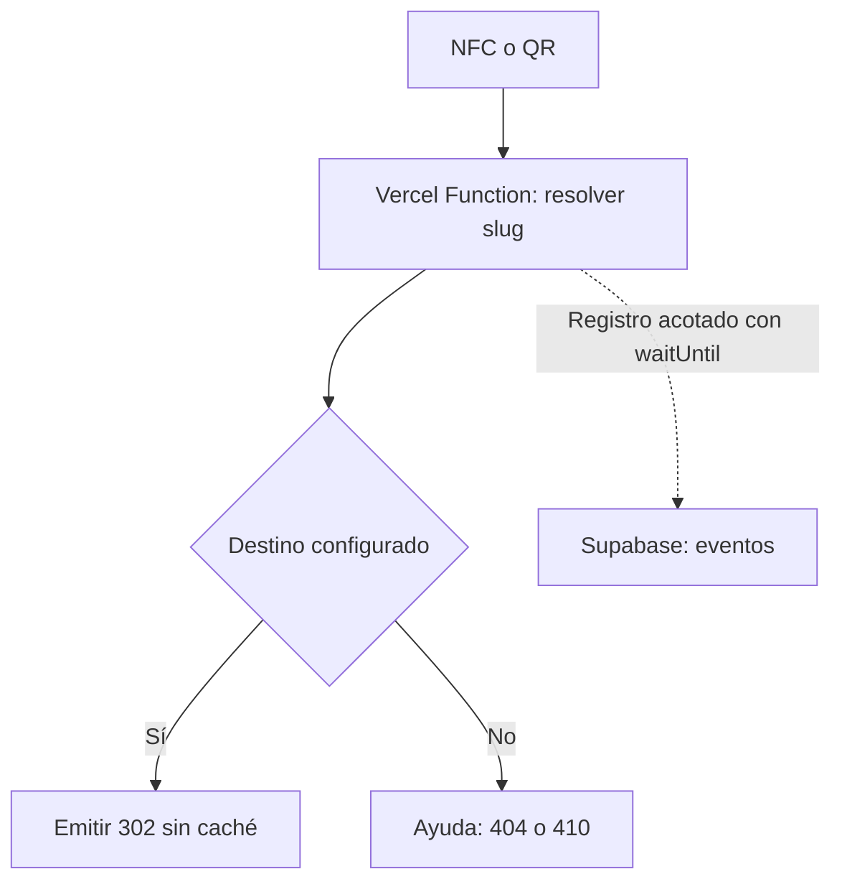

# Medición del sitio y Smart Links — propuesta revisable

Fecha: 23 de noviembre de 2026. No se ha creado ninguna base de datos, cuenta ni servicio de pago.

## Estado y activación de Web Analytics

`@vercel/analytics` no aparece en package.json ni en el lockfile de la base auditada. Su instalación no pudo completarse: el entorno no resuelve los servicios externos y no hay copia en caché. Propuesta preferida: instalar el SDK oficial con `npm install @vercel/analytics` cuando exista conectividad, conservando el lockfile generado. React + Vite es compatible con la integración React oficial.

Se preparó una integración opcional sin dependencia en `SiteMeasurement.tsx`, basada en la cola y script de primera parte documentados en el SDK público de Vercel. Por defecto NO recoge datos externos. No se afirma que el panel esté habilitado ni que existan visitas recibidas. El plan y el proyecto Vercel efectivos no se pudieron consultar.

Antes de activar:

1. En el proyecto Vercel correcto, comprobar plan, límites y uso compartido del equipo; abrir Analytics y habilitar Web Analytics.
2. Elegir UNA integración: puente incluido o SDK oficial. Recomendamos el SDK cuando se pueda instalar. Si se migra, retirar del puente la inyección de script y sus pageviews; usar una única instancia de `Analytics` de `@vercel/analytics/react`, con filtro `beforeSend` equivalente. Conservar un solo responsable de los eventos comerciales.
3. Para el puente: establecer `VITE_WEB_ANALYTICS_ENABLED=true` en el entorno de producción. Mantener `VITE_VERCEL_CUSTOM_EVENTS=false` hasta comprobar que el plan permite eventos personalizados. Estas variables son públicas y se incorporan en el build; no son credenciales.
4. Solicitar autorización de despliegue. Después del despliegue autorizado, comprobar script y peticiones de Analytics, navegación Home → Demo → Home y recepción en panel. No confundir script descargado con dato recibido.
5. Revisar exclusiones y duplicación con un navegador limpio. Registrar evidencia de un solo pageview por navegación, sin contar saltos de ancla. No añadir otro snippet en index.html, tag manager o layout.

El puente solo envía en build de producción y dominio exacto `reviews.absoftwareworks.com`. Las rutas `/r/*` y desconocidas quedan fuera de esta analítica comercial. Los parámetros y fragmentos se eliminan; no enviamos mensajes de WhatsApp, slugs de negocios ni datos de contacto. `?internal=1` excluye la visita y conserva la exclusión en sessionStorage de esa pestaña. Cerrar esa pestaña termina la exclusión. Restricciones de almacenamiento y bloqueadores pueden reducir la medición; no se promete exhaustividad.

El catálogo usa IntersectionObserver: una entrada del catálogo en el viewport por montaje de Home; no significa que los tres productos se hayan leído. El listener de clics tiene cleanup y una sola ruta de emisión. Los pageviews manuales usan `disableAutoTrack`; el temporizador cancelable evita el replay de efectos de StrictMode. Las pruebas automatizadas cubren la política de rutas y exclusiones, no la recepción de Vercel.

## Diccionario comercial

| Evento | Disparador | Interpretación |
| --- | --- | --- |
| catalog_view | Entrada visible de la sección de productos | Exposición al catálogo, no lectura completa |
| demo_click | Enlace hacia /demo desde Home | Intención de probar; no mezclar con pageviews de Demo |
| whatsapp_click | Enlace wa.me desde Home/Demo | Clic de salida, no conversación enviada |
| card_inquiry | WhatsApp de Card | Intención por Card |
| stand_inquiry | WhatsApp de Stand | Intención por Stand |
| kit_inquiry | WhatsApp de Kit | Intención por Kit |
| email_click | Enlace mailto de la web comercial | Apertura solicitada al cliente de correo, no correo enviado |

Solo se envía la propiedad `page` (Home o Demo). Los tres eventos de consulta se identifican mediante `data-product`; el piloto no se atribuye a un producto. Un clic de producto produce whatsapp_click y SU evento de producto: son dos dimensiones del mismo clic, no sumar sus totales como leads. Los clics repetidos son clics repetidos, no personas únicas. En preview se emite `ab-reviews:measurement` sin transporte ni almacenamiento; es un punto de prueba y no un sistema de métricas persistente.

## Planes y alternativa

Consulta de documentación oficial: 23/11/2026. Los precios son orientativos en USD; confirmar en cuenta antes de contratar. No asumimos cuál utiliza AB Reviews.

| Servicio | Referencia publicada | Decisión propuesta |
| --- | --- | --- |
| Web Analytics Hobby | 50.000 eventos/mes compartidos por equipo, ventana de 1 mes; sin eventos personalizados | Pageviews donde el plan sea aplicable; no activar custom events |
| Web Analytics Pro | Eventos personalizados, 2 propiedades; uso publicado de USD 3/100.000 eventos y condiciones/créditos del plan | Revisar presupuesto efectivo; no contratar para este sprint |
| Supabase Free | USD 0; 500 MB de BD/proyecto y 5 GB de egreso; sin backups automáticos de pago | Suficiente para evaluar un piloto pequeño; exportación propia y revisar pausa por inactividad |
| Supabase Pro | Desde USD 25/mes; 8 GB y backups diarios, consumo adicional según cuotas | Considerar solo cuando continuidad y volumen lo justifiquen |

Vercel describe Hobby como uso personal no comercial: comprobar encaje del alojamiento comercial actual, independientemente de la analítica. No se ha cambiado el plan. El costo total de Functions depende del plan, ejecución, solicitudes y egreso: no puede afirmarse costo total cero sin conocer la cuenta.

Alternativa sin comprar una suscripción de analítica: mantener el registro manual de invitaciones, conversaciones y ventas del piloto, con pageviews si el alojamiento lo permite. Tras aprobar la arquitectura, un endpoint propio con Supabase Free puede guardar una lista cerrada de eventos comerciales, sin mensajes ni identificadores personales; añadir cuotas, validación, filtros de bots y agregación. No implementado. No disfrazar clics como páginas para eludir límites del plan. GA4 es otra opción gratuita con eventos, pero requiere revisar configuración de privacidad y es una integración adicional que este sprint no instala.

## Arquitectura de Smart Links recomendada

Estado actual: React resuelve `reviewClients.ts`; modo `redirect` usa `window.location.replace` con enlace manual de respaldo; modo `page` presenta acciones y modo `demo` simula sin publicar. Solo existe el cliente demo en el registro actual. El wildcard SPA devuelve la página de ayuda para slugs inválidos; no es un 404 HTTP real. No hay captura automática de accesos ni backend. No cambiar silenciosamente el comportamiento del modo página.

Propuesta fase 1 para negocios que elijan redirección directa:

El registro del acceso se inicia en el servidor antes de devolver la respuesta y su finalización continúa con `waitUntil` de `@vercel/functions`. No hacer un fetch sin esperar dentro de una Function y asumir que sobrevivirá al fin de la respuesta. El resultado de Supabase nunca decide si se entrega el 302. Es registro de mejor esfuerzo: un fallo puede perder una métrica, pero debe conservar la redirección. Si se necesitara registro garantizado, habría que aprobar una cola durable y su costo adicional.

Conservar inicialmente destinos en un registro versionado del servidor independiente de Supabase: así su caída no impide resolver el negocio. Generar los registros de frontend y servidor desde la misma fuente para no mantener dos destinos divergentes. Si luego se trasladan los destinos a BD, aprobar caché/fallback durable e invalidación antes de migrar; un proceso de Function no es una caché permanente.

Cambiar `vercel.json` con una regla específica para `/r/:slug` ANTES del fallback SPA, apuntando a `/api/review?slug=:slug`. Probar primero en entorno aislado; no se ha cambiado la configuración en este sprint. `demo` y clientes `page` necesitan conservar su experiencia: reservar una ruta de renderizado distinta sin volver a invocar la Function en bucle. En modo página, registrar `landing_served` y, si se aprueba medir su botón principal, `google_redirect_issued` en un endpoint distinto. Nunca contabilizar una página servida como redirección a Google.

Enviar 302 temporal y `Cache-Control: no-store` para respetar cambios de destino y no ocultar visitas tras caché CDN. Validar slug y destino configurado HTTPS de Google, rechazar credenciales/puertos/dominios engañosos y nunca aceptar `?url=` como destino. El usuario no puede crear reseñas mediante estos parámetros.

## Datos mínimos propuestos

| Campo | Tipo y uso |
| --- | --- |
| event_id | UUID generado en servidor; clave primaria para reintentos del mismo evento |
| business_id | Identificador estable del negocio, sin usar email/RUT/teléfono |
| occurred_at | timestamptz UTC generado en servidor; informes agrupados en America/Santiago |
| source | enum nfc, qr, unknown |
| outcome | redirect_issued, landing_served, unavailable; no significa llegada ni publicación |
| http_status | 302, 200, 404 o 410 según la respuesta emitida |
| destination_version | Versión de configuración; no guardar toda la URL ni sus parámetros |

Una tabla de eventos con índice `(business_id, occurred_at)` basta para empezar. Negocios desconocidos: registro operativo agregado de fallos, sin guardar slugs arbitrarios como si fueran negocios. Definir retención propuesta de 90 días para eventos y conservar agregados diarios; aprobar y documentar antes de activar. Estimación de capacidad: 100.000 eventos a ~0,5–1 KB incluyendo índices son ~50–100 MB; medir tamaño real, no tomarlo como cuota garantizada.

NFC: `/r/negocio?source=nfc`; QR: `/r/negocio?source=qr`; enlaces antiguos sin parámetro: unknown. Comparten identidad y destino, pero sus URLs difieren en el marcador. No se puede inferir NFC/QR de forma fiable si ambos usan la URL idéntica. El marcador es declarativo, copiable y no autenticado; no prueba qué dispositivo físico produjo el acceso. El generador actual aún produce URLs sin marcador: no inventar atribución retroactiva.

Filtrado antes de insertar: no contar HEAD, OPTIONS, prefetch ni agentes conocidos de bots/previsualización. Inspeccionar headers transitoriamente; no almacenar IP, user-agent completo, huella, referrer, cookies de identidad ni geolocalización. Las visitas de QA deben usar un marcador interno o mecanismo acordado; registrar por separado errores técnicos. Estos filtros no eliminan todos los bots ni hacen fiable el conteo de personas únicas. Reportar accesos filtrados, no personas.

Supabase: clave privilegiada solo en variables del servidor (sin prefijo VITE_), acceso público denegado con RLS/permisos y sin tabla consultable desde el frontend. No crear API pública de lectura de eventos. Limitar inserciones, tiempo y reintentos; establecer timeout corto para almacenamiento, sin demorar el 302. No exponer mensajes de BD en respuestas. Revisar acceso de administración y exportación privada.

## Pruebas exigidas antes de implementar/activar

- Cliente activo devuelve 302 correcto; inactivo 410; inexistente 404; demo/page sin bucles ni cambio de experiencia.
- Sin Supabase, con clave ausente, timeout y error 500: la redirección válida sigue funcionando.
- No hay caché de 302; cambiar destino conserva slug y funciona inmediatamente según versión publicada.
- source inválido/ausente → unknown; parámetros no controlan el destino; ningún secreto aparece en bundle.
- Bots conocidos, HEAD, prefetch y pruebas internas excluidos; documentar falsos positivos y pérdidas.
- Un event_id no se inserta dos veces al reintentar; dos accesos reales son dos eventos.
- Medir p50/p95 de redirección y error antes/después; objetivo propuesto de sobrecosto de lógica <50 ms en caliente, pendiente de medir en región elegida.
- Comparar contra conteo manual de una muestra. Las aperturas no son reseñas: Google no notifica aquí quién publicó. No automatizar publicaciones ni asignar una tasa de reseñas/accesos a personas únicas.

## Fuentes primarias

- [Vercel: inicio de Web Analytics](https://vercel.com/docs/analytics/quickstart)
- [Vercel: precios y límites](https://vercel.com/docs/analytics/limits-and-pricing)
- [Vercel: eventos personalizados](https://vercel.com/docs/analytics/custom-events)
- [SDK público: cola, script y disableAutoTrack](https://github.com/vercel/analytics/blob/main/packages/web/src/generic.ts)
- [Vercel: planes](https://vercel.com/pricing)
- [Supabase: precios](https://supabase.com/pricing)
- [Supabase: cuotas y facturación](https://supabase.com/docs/guides/platform/billing-on-supabase)
